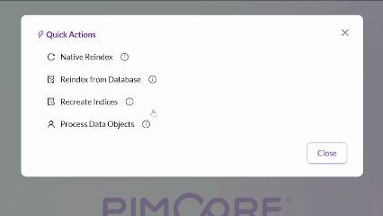

# Pimcore Helpers Bundle

A collection of helpful services, utilities, and extensions for Pimcore.

See the [changelog](CHANGELOG.md) for breaking changes between versions.

## Installation

1. Install the composer package:
    ```shell
    composer require torq/pimcore-helpers-bundle
    ```
2. Add the bundle to `Kernel.php` or `bundles.php`:
    ```php
    $collection->addBundle(new TorqPimcoreHelpersBundle());
    ```
3. (Optional) If using the `HashedInput` custom field type, make sure to add the "torq_pimcore_helpers.secret" parameter
   to the Symfony container in `services.yaml`:
    ```yaml
    parameters:
        torq_pimcore_helpers.secret: "%env(MY_SECRET_VAR)%"
    ```

## Repository

The repository pattern wraps fetching, saving, and deleting Pimcore elements (assets, objects, etc.). There are several
benefits to this pattern:

* **Co-location of fetching logic**; complicated querying logic can be encapculated into a single spot, promoting
  reusable queries over random queries sprinkled throughout the service layer.
* **Mocks for testing**; mocking static database read/writes is challenging, mocking a repository method is easy.

## Normalizer

A full set of Symfony normalizers for Pimcore's unique object types including data objects, asset, field collections,
object bricks, blocks, classification stores, etc.

### OpenAPI model describers

The normalizers also describe the shape of what they output, so an endpoint can document a data object without a
hand-written model. This needs `NelmioApiDocBundle` to be registered in the project.

Reference the class as a model:

```php
#[OA\Response(response: 200, content: new OA\JsonContent(ref: new Model(type: Product::class)))]
```

The schema is built by the same normalizer which serializes that class, using the same context. To shape both the
output and its schema, extend a normalizer and set the context it always applies:

```php
#[Autoconfigure(tags: [['name' => 'serializer.normalizer', 'priority' => -1]])]
class ProductNormalizer extends DataObjectNormalizer
{
    protected function addRequiredContext(array $context): array
    {
        return HelperContextBuilder::create()
            ->withContext($context)
            ->excludeFields(['internalNotes'])
            ->relationsAsIds()
            ->toArray();
    }

    public function supportsNormalization(mixed $data, ?string $format = null, array $context = []): bool
    {
        return $data instanceof Product;
    }

    public function getSupportedTypes(?string $format): array
    {
        return [Product::class => true];
    }
}
```

A normalizer for the exact class is used ahead of one for a parent class, so `ProductNormalizer` describes `Product`
and `DataObjectNormalizer` describes every other data object.

What gets described:

* Fields, from their class definition: scalars, dates, relations, object bricks, field collections and blocks.
* Relations as IDs when the context sets `relationsAsIds()`, and otherwise as a reference to the related class.
* Assets, quantity values, ranges, videos, galleries and listings.
* Classification stores, element properties and asset metadata are described as a generic object, because their
  shape lives in the database.

To describe a value class of your own, implement `DescribingNormalizerInterface` on its normalizer, use
`PimcoreModelSupportTrait`, and inject `PimcoreModelDescriber` for anything the normalizer doesn't describe itself:

```php
class PriceNormalizer implements DescribingNormalizerInterface
{
    use PimcoreModelSupportTrait;

    public function __construct(protected PimcoreModelDescriber $describer) {}

    public function describe(Model $model, Schema $schema): void
    {
        $this->describer->describeObject(['amount' => 'number', 'currency' => 'string'], $schema);
    }

    // normalize(), supportsNormalization() and getSupportedTypes() as usual
}
```

## Startup Commands

Set the `#[AsStartupCommand]` attribute on a Symfony command and add the following to the deploy or startup script:

```shell
bin/console torq:run-startup-commands
```

To automatically run that command on deploy/start-up. Startup commands are tracked in the `startup_command_runs`
database
table and are only run once by default. Set `#[AsStartupCommand(repeatable: true)]` to define a command which should be
run every time.

## Studio Quick Actions

Quick Actions are simple one-click commands – queue a job, clear a cache, trigger a resync. Requires the
`quick_actions` permission to use.



### Defining custom actions

To define a quick action, set up the bundle as a Module Federation remote for your Studio extension:

```typescript
// rsbuild.config.ts

import {defineConfig} from "@rsbuild/core";
import {pluginModuleFederation} from "@module-federation/rsbuild-plugin";

export default defineConfig({
    // Set dts for development builds only, production builds do not need types
    dts: {
        consumeTypes: {
            remoteTypeUrls: {
                pimcore_helpers_bundle: {
                    alias: "@torq/pimcore-helpers-bundle",
                    zip: "http://localhost:3033/@mf-types.zip",
                    api: "http://localhost:3033/@mf-types.d.ts",
                },
            },
        },
    },
    plugins: [
        pluginModuleFederation({
            remotes: {
                "@pimcore/studio-ui-bundle": createDynamicRemote("pimcore_studio_ui_bundle"),
                "@torq/pimcore-helpers-bundle": createDynamicRemote("pimcore_helpers_bundle"),
            },
        })
    ]
})
```

Then register the action as a dynamic type using the registry:

```typescript jsx
// CustomQuickActionPlugin.tsx

import {container, IAbstractPlugin} from "@pimcore/studio-ui-bundle";
import {QUICK_ACTION_REGISTRY_SERVICE_ID, type QuickActionRegistry} from "@torq/pimcore-helpers-bundle";

export const CustomQuickActionPlugin: IAbstractPlugin = {
    name: "CustomQuickActionPlugin",

    onInit({container}) {
        const registry = container.get<QuickActionRegistry>(QUICK_ACTION_REGISTRY_SERVICE_ID);
        registry.registerDynamicType({
            id: "custom-quick-action",
            title: "Custom Quick Action",
            permission: "custom_action_permission", // set null for no permission. Users must still have quick_actions permission
            onClick: async (signal?: AbortSignal) => {
                await triggerCustomAction(signal);
            },
        });
    },
};
```

### Opening the modal from elsewhere

The Quick Actions modal is opened from a button in the left sidebar by default. `useQuickActionsModal()` returns
`open` and `close` callbacks which work from any Studio component, so the modal can be opened from a different entry
point.

## Testing

The bundle has no kernel of its own, so its tests run from a host Pimcore project which autoloads
`Torq\PimcoreHelpersBundle\Tests\` from the bundle's `tests/` directory. Run them inside the host's PHP container,
using the host's PHPUnit bootstraps:

```shell
# Unit tests
vendor/bin/phpunit --bootstrap=tests/bootstrap.php --exclude-filter Functional <path-to-bundle>/tests

# Tests which need a kernel
KERNEL_CLASS='App\Kernel' vendor/bin/phpunit --bootstrap=tests/Functional/bootstrap.php <path-to-bundle>/tests/Functional
```

# License

This bundle is licensed under the Pimcore Open Core License (POCL)
and is intended for use with Pimcore Platform 2025.1 and newer.

See LICENSE.md for full license text.

